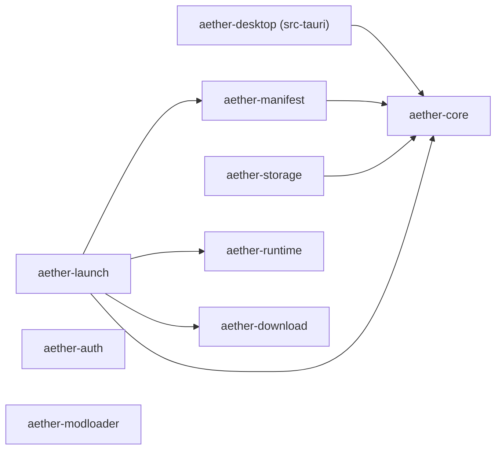

# 架构概览

Aether Launcher 分两层：Rust workspace 放领域逻辑，React 前端放界面，中间由 Tauri 2 的 IPC 连接。

```text
React + Fluent UI  ──(Tauri IPC)──  src-tauri (aether-desktop)  ──  crates/*
```

## Crate 依赖



`aether-core` 在最底层，只放实例和版本的基础类型。`download`、`auth`、`modloader`、`runtime` 目前互不依赖，也不依赖 core。

## Crate 一览

| Crate | 职责 | 现有内容 |
| --- | --- | --- |
| `aether-core` | 实例与版本的领域模型 | `InstanceId`（UUID v4）、`VersionId`（拒绝空串）、`InstanceState`（ready / incomplete / running / failed）、`GameInstance` |
| `aether-manifest` | Minecraft 版本元数据 | `parse_version_manifest` → `VersionManifest`（`id`、`inheritsFrom`、`mainClass`、`assetIndex`、`downloads.client`、`javaVersion`、`libraries`、`arguments` / `minecraftArguments`）；`rules`（`Rule`、`Environment`、`rules_allow`）；`arguments`（`expand_arguments`）；`merge_with_parent`（继承合并），`load_version_manifest`（从本地磁盘安全加载完整继承链） |
| `aether-download` | 下载计划与校验 | `ArtifactSource`、`DownloadArtifact`、`DownloadPlan::validate`；`native_zip::preflight_native_zip` 验证 ZIP 条目名称、文件类型、重复目标和解压大小限制 |
| `aether-auth` | 账户模型 | `AccountId`、`AccountKind`（Microsoft / Offline）、`AccountProfile` |
| `aether-runtime` | Java 运行时与本机内存 | `JavaRuntime`、`supports`；`memory::system_memory` 读取物理内存（Windows 用系统接口，Linux 读 `/proc/meminfo`，macOS 用 `sysctl` 和 `vm_stat`）；跨平台检测 PATH / JAVA_HOME / 常见安装目录和 Minecraft runtime，探测 Java 版本、架构与厂商 |
| `aether-launch` | 启动请求与计划 | `LaunchRequest`、`LaunchPlan`；`select_java_runtime` 选 Java；`build_launch_plan` 组装 JVM / classpath / 游戏参数；`build_native_plan` 选择 native JAR 并输出下载计划；`build_install_plan` 从已校验的版本 JSON 生成客户端 JAR、Libraries 和 native 压缩包的下载计划；`GameProcess` 监督子进程并捕获有界日志；`InstanceProcessRegistry` 按实例 ID 管理进程；`InstanceLaunchCoordinator` 从可信实例文件准备启动并校验客户端 JAR |
| `aether-modloader` | 模组加载器 | `ModLoaderKind`（Fabric / Forge / NeoForge / Quilt）、`ModLoaderVersion` |
| `aether-storage` | 本地持久化 | `encode_instance` / `decode_instance`、`InstanceStore::load`（从受管理的 UUID 目录读取和验证实例） |

按现有类型推断，启动一次游戏时的分工是：`manifest` 解析版本，`download` 生成并校验下载计划，`runtime` 选 Java，`launch` 组装启动计划，`storage` 保存实例。目前还没有代码把它们串起来。

## 前端结构

```text
src/
├── main.tsx          入口
├── App.tsx           根：主题、Provider、页面切换
├── navigation.tsx    页面清单（id、名称、图标、说明）
├── shell/            自绘标题栏、可收起的导航栏、Logo
├── state/            应用层状态：导航、账户、实例列表、安装任务、游戏会话
├── pages/            主页、实例、下载、账户、设置
├── components/       版本总览与详情、安装进度、启动控件、对话框等
├── ipc/              对后端命令和事件的类型化封装
├── lib/              纯函数与小 hook（版本、安装进度、账户、动效、品牌主题）
└── styles/           base / shell / pages / motion 四份样式
```

没有路由库，页面切换就是 `App` 里的一个 state（`state/navigation.ts` 把它共享给页面）。窗口是无边框的，标题栏、导航栏、动效和 Mica 的细节见 [`docs/design/ui-shell.md`](design/ui-shell.md)。

配色方案有深色、浅色、跟随系统三种，默认深色。选择保存在 `localStorage` 的 `aether.theme`。`App` 把解析后的结果交给 Fluent 的 `FluentProvider`（组件配色），同时写到 `<html>` 的 `data-theme`。样式里的颜色、圆角、间距、动效时长全部取自 Fluent 的设计令牌（`var(--colorNeutralBackground1)` 之类），不要写死色值。`FluentProvider` 的 `className` 会同时落到它挂 Tooltip、Dialog 的门户根上，所以那个类只能定义变量，不能带尺寸和背景。

## IPC 边界

- 前端只通过 `src/ipc/` 调用后端，组件里不直接 `invoke`。
- 命令在 `src-tauri/src/lib.rs` 里用 `#[tauri::command]` 定义，并列进 `generate_handler!`。目前有 `application_info`、`list_java_runtimes`、`system_memory`、`list_minecraft_versions`、`list_instances`、`install_vanilla_version`、`cancel_vanilla_install`、`start_installed_instance`、`stop_installed_instance`、`game_status`、微软登录用的 `microsoft_login_available`、`begin_microsoft_login`、`cancel_microsoft_login`、`open_microsoft_verification_page`、`list_microsoft_accounts` 和 `remove_microsoft_account`（见 [microsoft-login.md](modules/microsoft-login.md)），以及导入用的 `pick_import_folder`、`detect_launcher_installations`、`pick_launcher_folder` 和 `import_versions`（见 [import.md](modules/import.md)）。安装进度走 `install://progress` 事件，导入进度走 `import://item` 事件。
- 窗口权限在 `src-tauri/capabilities/default.json`：`core:default`，加上自绘标题栏需要的最小化、最大化、关闭、拖动和设置主题。这个目录在 CODEOWNERS 里单独列出。
- 命令是窄化的领域操作（导入这个实例、启动这个实例），参数用类型表达。不提供执行任意命令、读写任意路径的入口。

新增一个命令：

1. 逻辑放在对应 crate 里并写测试，`src-tauri` 里的命令只负责转换参数和结果。
2. 在 `src-tauri/src/lib.rs` 里添加命令函数，并加入 `generate_handler!`。
3. 需要新权限时修改 `capabilities/`。
4. 在 `src/ipc/index.ts` 的 `CommandResults` 里登记命令名和返回类型，再加一个封装函数和测试。

`callCommand`（`src/ipc/call.ts`）按 `CommandArgs` / `CommandResults` 两张登记表检查命令名、参数和返回值，各领域的命令登记在自己的文件里。

Java 发现命令 `list_java_runtimes` 是只读且无参数的 IPC：Tauri 使用 `spawn_blocking` 调用 `aether_runtime::discover_java_runtimes`，避免阻塞窗口线程。返回字段统一采用 camelCase（`executable`、`majorVersion`、`architecture`、`vendor`），未识别到安装时返回空数组；任务内部失败则返回错误。前端仅通过 `src/ipc/index.ts` 的 `listJavaRuntimes()` 调用。该命令不会接受来自前端的任意可执行文件路径。

## 版本继承

`VersionManifest::merge_with_parent` 把子版本（Fabric、Forge 等）叠加到已经解析好的父版本上。多级继承由调用方从最顶层的父版本开始逐级合并。

- 库：子版本在前、父版本在后。group、artifact、classifier 和规则都相同的库只留一个，版本更高的赢，版本相同留子版本的。规则不同的同名库都保留（比如各平台的 natives）。名字不是 Maven 坐标的库不参与去重。
- 参数：父版本在前、子版本在后。
- 其他字段：子版本有就用子版本的，没有就用父版本的。
- 版本按段比较：数字按数值比，`1.0` 大于 `1.0-beta`，`1.0` 等于 `1.0.0`。

库顺序、参数顺序和「新版本优先」参考了 HMCL v3.17.0.362 的合并行为，只参考行为，没有复制代码。

`aether_manifest::load_version_manifest(game_directory, version_id)` 从 `versions/<id>/<id>.json` 加载当前版本，沿 `inheritsFrom` 从父级到子级逐层合并，最终保留子版本 ID。所有版本必须在本机存在；找不到父版本会返回错误。入口拒绝路径分隔符和 Windows 特殊设备名，并验证规范化后的文件路径属于 `versions/` 目录；循环继承和超过 32 层的继承都会拒绝，单个 JSON 有 8 MiB 大小上限。调用者需显式提供已信任的游戏目录，此 API 不暴露可传入任意路径的 Tauri IPC。

`aether_launch::select_java_runtime` 根据解析结果中的 `javaVersion.majorVersion` 在已发现的 Java 运行时中匹配完全相同的主版本，返回首个匹配实例；没有需求、找不到匹配或主版本超出 `u16` 范围都以明确错误返回。旧版未提供 `javaVersion` 时暂不猜测 Java 8。


## 启动计划组装（现代版本）

`aether_launch::build_launch_plan(request, manifest, runtime, environment, options)` 将已解析的 `VersionManifest` 与已发现的 Java 运行时组装为 `LaunchPlan`（`runtime`、`working_directory`、按 argv 顺序排列的 `arguments`）。调用方需提供 `LaunchOptions`：游戏数据目录、工作目录、已下载的 **实际客户端 JAR**、已准备好的 natives 目录及认证/用户参数变量。继承版可能复用原版客户端 JAR，因此不能根据子版本的 `id` 猜测 JAR 文件位置。

- 先验证内存、Java 主版本与 `mainClass`；仅支持有 `arguments` 的现代版本。旧版 `minecraftArguments` 暂不自动拆词。
- 按当前系统和 features 的规则过滤 library。优先使用 `downloads.artifact.path`，否则由 Maven 坐标生成本地 `libraries` 相对路径；验证路径安全、存在性，并拒绝链接到 `libraries` 目录之外的库文件。
- classpath 按清单库顺序追加实际客户端 JAR，使用运行系统对应的路径分隔符。展开条件参数及 `${...}` 占位符；缺失变量明确报错，非递归展开；若 JVM 参数没有显式 `-cp` 则补齐。
- 不走 Shell，不执行 Java；认证变量可能包含访问令牌，不要记录或持久化完整 argv。
- natives 下载计划、已下载 JAR 的校验/安全提取和已安装目录的复核已实现；HTTP 下载、旧版参数仍待实现。独立 `natives-*` classifier JAR 由协调器准备后不进入 JVM classpath。

## Natives 下载计划与解包安全边界

清单的 `libraries[].downloads.classifiers`、`natives` 和 `extract.exclude` 已能反序列化。调用 `aether_launch::build_native_plan(manifest, environment)` 按操作系统、CPU 架构和库 rules 生成 `NativePlan`，其 `download_plan()` 复用已有的 `DownloadPlan::validate`。支持旧版 `natives-windows-${arch}` 的 32/64 位替换与现代 `group:artifact:version:natives-windows` 这样的独立分类器。元数据缺失时明确返回错误，不猜测不可靠的下载地址。

`aether_download::native_zip::preflight_native_zip` 是解包前的纯校验接口。它检查 ZIP 条目名称、路径穿越、Windows 保留名、重复输出、符号链接/特殊类型，并对条目数量（16384）、单文件未压缩大小（256 MiB）和全包未压缩总量（512 MiB）设限。排除规则（如 `META-INF/`）只能跳过已通过路径校验的条目。

**现已支持本地安装 natives：** `aether_download::verify::verify_local_artifact` 流式校验已有文件的大小与 SHA-1，拒绝链接到游戏根目录之外的文件；`aether_download::native_install::install_native_archives` 会先预检查所有 ZIP 条目，在同一文件系统上创建私有临时目录、使用 `create_new` 流式解压，并重新检查实际解压字节数。全部成功后只通过目录 rename 发布，失败时清理临时目录，已有的正式 natives 目录不被正常流程覆盖。上层使用 `NativePlan::install(game_directory, natives_directory)` 调用。

**安全及使用边界：** 此接口不下载文件，也不会调用带历史安全漏洞的 `ZipArchive::extract`。调用方必须保证游戏根目录没有不受信任进程并发篡改，并提供全新的、位于游戏根目录内的 natives 目录。ZIP 库升级至 9.0.5 以避开已公开的解压漏洞，对应 Rust MSRV 从 1.85 提升到 1.88。SHA-1 用于与 Mojang 清单核验文件内容，不视为抗恶意碰撞的签名机制。当前 `build_launch_plan` 会略过显式 native classifier 的 classpath 条目；调用方必须先确认所需 natives 已安全准备。

## 游戏进程管理（Rust 内部 API）

`aether_launch::GameProcess::spawn(&launch_plan, extra_redactions)` 直接执行已有的 `LaunchPlan`，不经过 shell。启动前检查 Java 可执行文件是已存在的绝对路径（并规范化路径）、工作目录已存在；stdin 关闭，stdout 和 stderr 各由独立线程读取，以免输出管道阻塞 Java 进程。进程可通过 `id()` 查看 PID，`try_wait()` 非阻塞查询退出状态，`wait()` 等待退出并收尾，`stop()` 强制结束**主进程**。丢弃运行中的句柄时也会尝试结束其主进程。

`drain_logs()` 非阻塞读取缓存日志，单条日志最多 8 KiB，缓冲队列上限 256 条；生产者遇到队列已满时丢弃日志、不阻塞进程输出，并通过 `discarded_logs()` 统计丢弃数。会脱敏常见 `--accessToken` / `--clientToken` 等参数对应的值，也支持显式提供其他脱敏词；**不得把完整 `LaunchPlan.arguments` 写入常规日志，或者把原始游戏输出当成无敏感信息的安全数据**。日志脱敏是尽力而为，额外凭据必须由调用方声明。

当前进程管理**只向 Rust 内部暴露**，没有提供允许前端自定义任意命令、路径或 argv 的 Tauri IPC。进程强制停止不能保证结束 Java 生成的全部子进程；`wait()` 在子进程后代继承标准输出句柄时也可能继续等待读线程。仍需实现实例级进程注册、受控启动入口、优雅停止及游戏退出事件，才能向 UI 开放。

## 按实例管理游戏进程

新增 `aether_launch::InstanceProcessRegistry`。它是 Rust 内部的内存注册表，用 `aether_core::InstanceId` 作为键，维护已启动游戏进程及其状态；调用方必须使用已验证、可信的 `LaunchPlan`，**不能把用户提供的任意 executable / argv 转发给注册表**。

- `start(instance_id, plan, redactions)` 阻止同一实例被重复启动；不同实例可并行运行。对于已经正常退出或手动停止的实例，允许重新启动。
- `status(instance_id)` 和 `list()` 使用非阻塞 `try_wait` 更新状态，公开 `Running`、`Exited`（退出码为成功）、`Stopped`（用户停止）和 `Failed`（自然异常退出）。`InstanceRunState::instance_state()` 将这些状态对应到已有 `InstanceState`：Running → Running，Exited/Stopped → Ready，Failed → Failed；不会覆盖磁盘中的实例信息。
- `drain_logs(instance_id)` 仅消费该实例已脱敏的有界 stdout/stderr 日志；`discarded_logs` 记录队列满时丢弃的日志数。查询状态不会主动删除末尾日志。
- `stop(instance_id)` 只结束该实例注册的主进程。重复停止、自然退出后的停止保持幂等，不会影响其他实例。
- `forget_finished(instance_id)` 只能清理已结束的实例，拒绝静默删除正在运行的进程；清理或重新启动会丢弃旧日志。注册表被销毁时，`GameProcess` 的析构行为会尝试结束尚在运行的主进程。

该注册表的方法要求可变引用（`&mut self`），供后端所有者序列化访问；目前**没有向 Tauri 暴露状态、启动或停止 IPC**。后续应先实现可信的实例目录加载与启动计划准备，再以仅接受已注册实例 ID 的有限域命令接入 UI；同时补充长期保留日志、后台状态轮询、进程树清理及优雅退出能力。

## 可信实例读取与启动协调（Rust 内部）

新增 `aether_storage::InstanceStore`，由后端指定 **受管理的存储根目录**，按 `instances/<UUID>/instance.json` 读取实例，不接受调用方给出的任意路径。它会限制实例记录的大小（128 KiB）、拒绝符号链接记录和跳转目录，检查 JSON 中的实例 UUID 与请求一致，且工作目录必须是该 UUID 对应的实例目录。`InstanceId` 现实现 `Display`，序列化后的 UUID 可直接用作目录名。

`aether_manifest::load_resolved_version_manifest` 在多级 `inheritsFrom` 合并时额外记录 `downloads.client` 来自哪个版本。不能把 Fabric 子版本的 `id` 误当作实际客户端 JAR 文件名。

`aether_launch::InstanceLaunchCoordinator` 将上述读取与 `JavaRuntime` 选择、客户端 JAR 本地大小/SHA-1 核验、`build_launch_plan` 和 `InstanceProcessRegistry` 串联。后端拥有可信 `instance_storage_root` 与 `game_directory`，`prepare(instance_id, memory_mib, runtimes, environment, account_variables)` 只从 UUID 加载受管理实例，不接受前端传入可执行路径、Java argv、客户端 JAR 路径或工作目录。对受信任的账户上下文可以用 `start` 启动准备好的计划；`status/list/drain_logs/stop/forget_finished` 将操作限定在已注册实例的进程句柄上。

**当前是受限协调器，不是完整 Minecraft 启动器。** 若 natives 缺失，协调器只在明确调用安装路径时提取已下载的档案；声明的 `assetIndex` 必须先通过真实文件的逐项校验，否则直接失败。只允许已经安装且能够验证客户端 JAR 的现代、资源要求完整满足当前条件的实例。未实现通用下载、微软账户验证、完整资产校验与 natives 自动安装的端到端编排。这些能力齐备之前，**不开放实例启动的 Tauri IPC**。受管理的存储根目录须为仅被可信启动器进程修改的目录，防止并发文件替换的竞态风险。

## 已安装 assets 与 natives 的启动前校验

`aether_download::assets::verify_installed_assets(game_directory, index_id, sha1, size)` 对 **已有的** `assets/indexes/<id>.json` 进行大小/SHA-1 核验，解析 `objects` 中的哈希与大小，并逐一校验 `assets/objects/<前两位>/<sha1>`。不使用逻辑资源名组装文件路径。索引最大 32 MiB、最多 250000 个对象、单文件最大 1 GiB；对象 hash 必须是 40 位十六进制，重复 hash 的声明大小必须一致。缺失、大小不符或 SHA-1 不匹配均会阻止启动。校验不联网，也不创建或修复文件。资源索引中的虚拟目录重映射尚未实现。

`NativePlan::verify_installed(game_directory, natives_directory)` 会验证来源 JAR 完整性，重复执行安全预检查，对照 ZIP 原始内容逐字节核验已解包的 native 文件，拒绝损坏、缺失、额外文件或符号链接。已存在的 natives 目录不因“目录存在”而默认可信。`InstanceLaunchCoordinator::prepare` 保持只读：如需 natives 而目录尚未安装，则返回 `NativesNotReady`。`prepare_and_install` 只会在目标不存在时将**已经下载**的 native JAR 安全解包到 `<game_directory>/natives/<实例UUID>`，并重新校验安装结果；如果已有目录被篡改，返回错误而不擅自覆盖。 `start` 使用这一准备路径，然后才启动 Java 进程。Native classifier JAR 仅用于提取，不进入 JVM classpath。

**仍待实现：** Mojang HTTP 下载与下载缓存回填、资源对象修复、legacy `virtual/legacy` assets、完整身份认证、运行时 Java 自动安装、模组加载器适配，以及进程组优雅关闭。当前接口仅供受信任 Rust 调用，假设游戏数据目录没有不受信任进程同时修改。未向 Tauri 提供任意命令或任意路径执行能力。

## 还没有的部分

- `aether-manifest` 能解析 libraries、arguments、assetIndex、`downloads.client` 和 `javaVersion`，并按规则过滤库、展开参数。还没有：`logging`，以及 `os.version` 的正则（带 `version` 的系统规则目前按不匹配处理）。
- `aether-download` 的 `DownloadPlan::validate` 检查来源非空、SHA-1 格式，以及 `destination` 是安全的相对路径：不含 `..`、盘符、Windows 保留名，`/` 和 `\` 都当作分隔符，大小写不敏感地不重复。下载和写盘本身还没有实现。
- `aether-runtime` 的 `JavaRuntime::supports` 要求主版本完全相等。Java 发现与探测已实现并通过只读 IPC 暴露，支持由 `aether-launch` 基于已解析清单匹配 Java 主版本，但还没有自动下载 Java、持久化首选运行时或启动进程。
- `aether-auth` 只有账户模型，没有 Microsoft / Xbox / Minecraft 登录流程，也没有凭据存储。
- `aether-storage` 只做 JSON 编解码，不读写磁盘。
- `aether-launch` 可以对现代版本生成启动计划，`NativePlan::install` 已能调用独立 natives 安装器，并增加了只接收后端 `LaunchPlan` 的 Java 进程监督 API；尚未整合为从实例一路启动游戏的完整流程。
- `aether-modloader` 目前只有类型。
